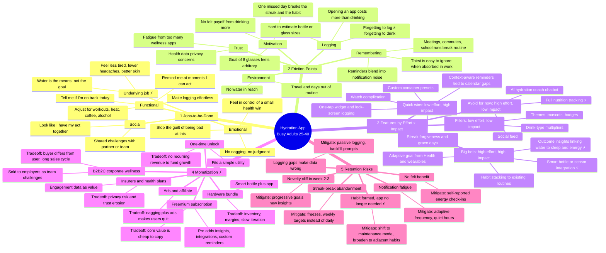

# Discovery Sprint Mindmap: Hydration App for Busy Adults (25–40)

**Target user:** Busy adults aged 25 to 40 who already know they should drink more water but forget to.
**The insight to keep in mind:** This is a problem of *remembering*, not a problem of *knowing*. Users don't need to be told why water matters. They need drinking to happen without having to think about it. Any idea that adds effort works against the problem we're solving.

⚡ = **Strategic tension.** These are real tradeoffs to debate in the sprint. Each one is expanded in the "Tensions to Debate" section at the end.

---

## 1. Core Jobs-to-be-Done

| Type | Job statement | Implication |
|---|---|---|
| Functional | "When I'm absorbed in work, remind me at a moment when I can actually drink." | Timing matters more than how often we remind |
| Functional | "Let me record a drink in under 2 seconds without breaking flow." | The widget, watch, and lock screen are the product; the app is secondary |
| Functional | "Tell me whether I'm on track today, adjusted for my day." | Adaptive goal, not a fixed 8 glasses |
| Emotional | "Help me feel like I'm taking care of myself without another source of guilt." | Supportive tone, no shaming |
| Social | "Let me do this with my partner or team so it sticks." | Light, opt-in, small groups only |
| **Underlying ⚡** | "Help me feel less tired, have fewer headaches, and focus better." | Water is how they get there. If we can't show a felt benefit, the app is just a reminder. |

**Discovery questions:** Do users actually measure success by volume of water, or by how they feel? What do they use today (a bottle with time markings, phone alarms, nothing)?

## 2. Key Friction Points

Ranked by hypothesized severity. Validate in interviews.

1. **Forgetting during deep work, meetings, and transitions.** This is the core problem.
2. **Logging takes more effort than drinking.** The app creates a new task. Users drink but don't log, so the data says they failed when they didn't.
3. **No felt payoff.** Drinking enough water has no immediate, noticeable reward.
4. **All-or-nothing streaks.** One bad day often ends the habit.
5. **Notification fatigue.** Busy adults already get 100+ notifications a day, and reminders become noise within a week or two.
6. **Arbitrary goals.** "8 glasses" isn't credible to this audience.

## 3. Feature Ideas: Effort vs. Impact

| Quadrant | Feature | Effort | Impact | Why |
|---|---|---|---|---|
| **Quick win** | One-tap widget, lock screen, watch logging | Low | High | Directly removes friction #2 |
| **Quick win** | Context-aware reminders (calendar gaps, after meetings, Focus mode respected) | Low–Med | High | Directly addresses friction #1 and #5 |
| **Quick win** | Custom container presets ("my bottle = 750 ml") | Low | Med–High | Removes estimation effort |
| **Quick win** | Grace days and weekly targets | Low | High | Prevents abandonment after a missed day |
| **Big bet** | Adaptive goal from Apple Health / Google Fit (workouts, weather) | Med | High | Makes the goal credible |
| **Big bet** | Habit stacking ("after coffee," "after standup") | Med | High | Builds durable behavior instead of depending on reminders |
| **Big bet ⚡** | Insights linking water to sleep and energy | High | High? | Could create the missing payoff, but correlations may be weak or misleading |
| **Big bet ⚡** | Smart bottle / sensor integration | High | High for a niche | Solves logging completely, but adds hardware cost and dependency |
| Filler | Themes, badges, mascot | Low | Low | Only if cheap; don't let it dilute the brand |
| Avoid | Social feed, AI chatbot coach | High | Low | Adds noise for users who are short on time |
| Avoid ⚡ | Full nutrition tracking | High | Unclear | Scope creep into a crowded category |

**Suggested MVP:** the four quick wins plus the adaptive goal.

## 4. Monetization Paths

| Path | Upside | Tradeoff / risk |
|---|---|---|
| **Freemium subscription** | Recurring revenue; standard in the category | Free alternatives are good enough, so paying at around $3/mo requires real Pro value (insights, integrations) |
| **One-time unlock** | Matches a simple utility; low friction | Revenue stops after purchase; harder to fund growth |
| **Hardware bundle** | Defensible; solves logging | Capital-intensive, slow to iterate, retail margin pressure |
| **B2B2C corporate wellness** | Larger contracts; employer pays | Buyer ≠ user; sales cycles of 6–12 months; needs aggregate reporting and must protect employee privacy |
| **Health plans / insurers** | Large market | Data sharing can destroy trust with a privacy-sensitive audience |
| **Ads / affiliate (bottles, electrolytes)** | Easy to add | Ads on top of reminders push users to churn faster |

## 5. Retention Risks and Mitigations

| Risk | Signal to watch | Mitigation |
|---|---|---|
| Notification fatigue | Notifications disabled, reminder dismissal rate | Adaptive frequency, back off after ignored reminders, respect Focus mode |
| Novelty cliff (week 2–3) | D7→D30 drop | Progressive milestones, first insight delivered around day 10 |
| Streak-break abandonment | Churn within 48 hours of a missed day | Grace days, weekly framing, "welcome back" instead of reset |
| **Habit formed → app unnecessary ⚡** | Drinking is stable but app opens fall | Decide whether this counts as success (see tension C) |
| No felt benefit | Low NPS, high early churn | Short energy and headache check-ins to make progress visible |
| Inaccurate data from missed logs | Days with zero logs while user is still active | Passive or one-tap logging, "did you drink earlier?" backfill prompt |

---

## ⚡ Strategic Tensions to Debate

**A. Reminder app vs. outcome app.**
Should we position the app as "never forget to drink" (narrow, easy to explain, easy to copy) or "feel more energized" (more defensible and higher willingness to pay, but requires believable outcome evidence and carries health-claim risk)? This choice drives positioning, pricing, and the roadmap.

**B. Engagement metrics vs. invisibility.**
The best experience for this user is one where they barely need to open the app (widgets, watch, passive logging). That pulls against DAU and session metrics, and against in-app upsell surfaces. **Decide the north-star metric up front.** Hydration-goal days per week is probably better than app opens.

**C. Is graduation churn a failure?**
If we succeed, users may form the habit and stop needing us. Options: (1) accept it and price for a short lifetime (one-time purchase, B2B); (2) expand to adjacent micro-habits such as standing, stretching, and sleep wind-down, which risks diluting focus; (3) keep a light maintenance mode. This choice affects the monetization model directly.

**D. Who pays: user or employer?**
B2C freemium keeps us close to the user. Corporate wellness pays better but changes what we build: admin dashboards, aggregate reporting, team challenges, and a workforce that may be skeptical of employer-monitored health data.

**E. Hardware: moat or distraction?**
A smart bottle removes logging friction completely and is hard to copy, but it turns a software startup into a hardware business. Possible middle path: integrate with existing third-party bottles instead of building our own.

**F. Scope: stay narrow or broaden?**
Water alone may be too thin to sustain a subscription. Broadening to caffeine, alcohol, or nutrition adds value but puts us in direct competition with established apps and works against our "effortless" promise.

---

## Suggested Sprint Validation Plan

- **Interviews (8–12):** Probe the underlying job (tension A). Ask what they've already tried and why they quit (retention risks). Ask about willingness to pay and who they'd expect to pay.
- **Fake-door tests:** Pro insights paywall, and "Is your company interested?" (B2B demand signal).
- **Prototype test:** Widget-only logging vs. in-app logging, comparing completion rate and time to log.
- **Data to gather:** Notification opt-in and disable rates in comparable apps, D30 retention benchmarks for the habit-tracker category.
