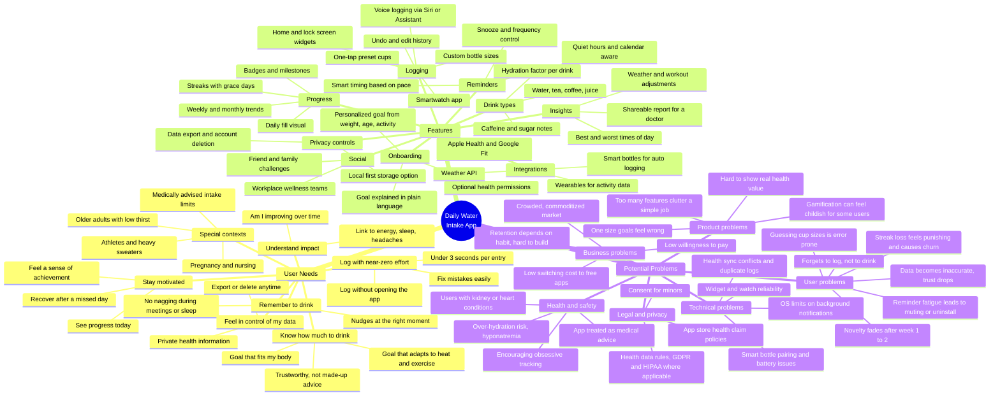

# Mindmap: Daily Water Intake App

A PM view of a mobile hydration tracker, organized around three questions: **what do users need**, **what do we build to meet those needs**, and **what could go wrong**.

## Needs → Features → Risks

How the three branches connect. Each core need maps to the feature that addresses it and the main risk to watch.

| User need | Key feature(s) | Main risk | Mitigation |
|---|---|---|---|
| Know how much to drink | Personalized, adaptive goal | Goal feels arbitrary or unsafe | Show the "why"; cap goals; medical disclaimer and override |
| Remember to drink | Smart, calendar-aware reminders | Reminder fatigue → uninstall | Adaptive frequency, easy snooze, quiet hours by default |
| Log with zero effort | Widgets, watch, voice, presets | Missed logs → bad data → lost trust | Lock screen logging; "catch-up" prompt at end of day |
| Stay motivated | Fill visual, streaks, badges | Streak loss causes churn | Grace days and streak repair; celebrate weekly consistency |
| Understand impact | Trends and correlations | Weak or misleading insights | Only show insights with enough data; avoid health claims |
| Control my data | Privacy settings, export, delete | Health data breach or misuse | Data minimization, local-first option, clear consent |

## MVP scope suggestion

- **In:** personalized goal, one-tap logging + widget, smart reminders with quiet hours, daily progress + streaks with grace days, Apple Health / Google Fit sync.
- **Later:** drink-type hydration factors, insights, social challenges, smart bottles, doctor reports.
- **Riskiest assumption to test first:** users will keep logging past week 2 if logging takes under 3 seconds and reminders adapt to their pace.
